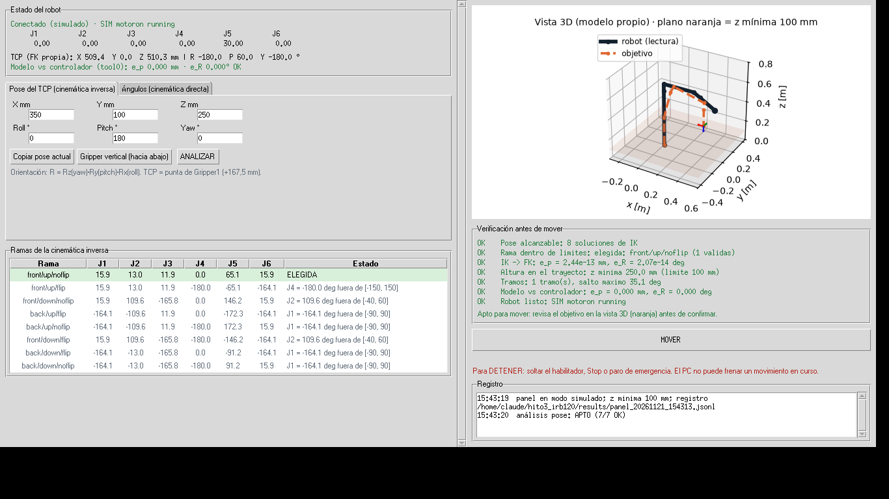
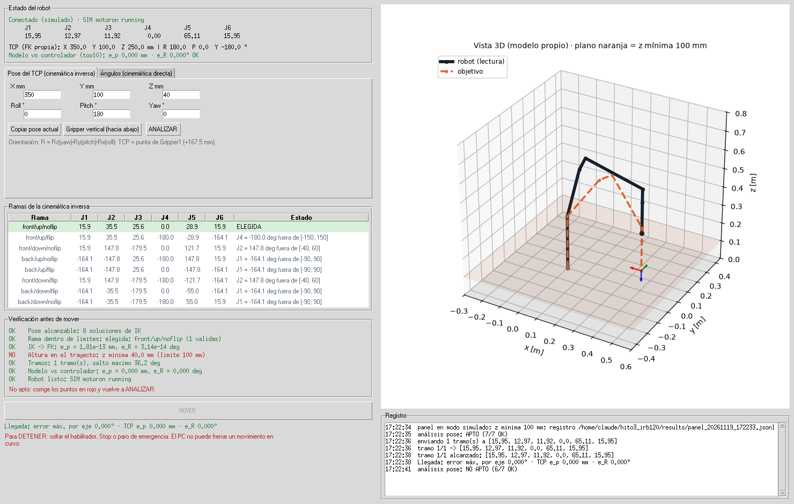
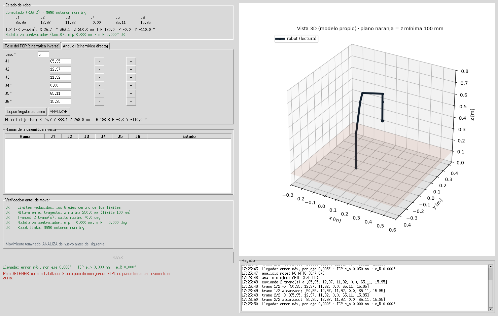

# Panel gráfico IRB 120: verificar antes de mover

El panel cumple lo que pide el docente: **la PC calcula si la posición pedida es posible**
(cinemática inversa y directa propias, límites, altura en todo el trayecto, modelo vs.
controlador) y **recién entonces habilita el botón MOVER**. Funciona en Windows sin compilar
nada (tkinter + matplotlib, incluidos en el Python de ROS 2 Humble).



## Cómo se abre

Desde la carpeta del repositorio (`C:\robotica\hito3_irb120`), en la consola de ROS:

| Modo | Comando | Para qué |
|---|---|---|
| Simulado | `python tools\panel.py` | practicar sin robot ni red |
| Directo | `python tools\panel.py --modo directo --robot 192.168.125.1` | robot real sin ROS (RWS + socket) |
| Directo contra el simulador | `python tools\panel.py --modo directo --robot 127.0.0.1 --rws http://127.0.0.1:8080` | con `tools\mock_irc5.py` corriendo |
| ROS 2 | `ros2 run irb120_bridge panel --modo ros` | con el bringup corriendo (abajo) |

Para el modo ROS 2, primero en otra consola:

```bat
ros2 launch irb120_bridge bringup.launch.py mode:=real command:=true
```

Opciones: `--z-min 120` (altura mínima del TCP en mm; debe coincidir con `rb_Z_MIN` del RAPID),
`--velocidad 25` (mm/s, modo directo).

## Cómo se usa

1. Elige el objetivo:
   - **Pose del TCP (cinemática inversa):** X, Y, Z en mm y roll, pitch, yaw en grados
     (R = Rz(yaw)·Ry(pitch)·Rx(roll)). «Gripper vertical» pone roll 0, pitch 180, yaw 0.
   - **Ángulos (cinemática directa):** J1…J6 en grados, con botones − / + por eje. Debajo se
     muestra la pose que resulta (FK propia).
2. Presiona **ANALIZAR**. El panel muestra:
   - las **8 ramas** de la IK con su motivo si se descartan, y la **elegida** (la válida más cercana);
   - **7 chequeos** (todos deben dar OK):

| # | Chequeo | Criterio |
|---|---|---|
| 1 | Pose alcanzable | la IK analítica tiene solución |
| 2 | Rama dentro de límites | límites reducidos del puente (los mismos que el RAPID) |
| 3 | IK → FK | FK(q elegida) reproduce la pose: e_p ≤ 0,01 mm, e_R ≤ 0,01° |
| 4 | Altura en el trayecto | el TCP no baja de z mínima en **ningún punto** del movimiento articular |
| 5 | Tramos | el movimiento se parte en tramos de ≤ 40° por eje |
| 6 | Modelo vs. controlador | FK propia de tool0 vs. pose que informa el IRC5: ≤ 1 mm, ≤ 0,2° |
| 7 | Robot listo | conectado, motores encendidos, RAPID corriendo, sin otro movimiento |

3. Mira la vista 3D: en negro el robot leído, en naranja punteado el objetivo y el plano naranja la z mínima.
4. **MOVER** se habilita solo si todo es OK **y el robot no se movió desde el análisis** (si
   alguien mueve el robot con el joystick, hay que volver a analizar). Pide confirmación.
5. Al terminar, el panel verifica la **llegada** con una lectura posterior al movimiento: error por
   eje y error de la pose del TCP. Hay que analizar de nuevo antes del siguiente movimiento.

Cada análisis, envío, tramo y llegada queda en `results\panel_<fecha>.jsonl`, que sirve como evidencia para la bitácora.



*Ejemplo de rechazo: la pose es alcanzable y está dentro de los límites, pero el TCP quedaría a
40 mm (z mínima 100 mm). MOVER queda deshabilitado.*

## Por qué se revisa todo el trayecto y no solo el destino

`MoveAbsJ` interpola en el espacio articular, así que el TCP **no** va en línea recta. En las pruebas
(`test_analisis.py`) hay un caso real: los dos extremos están a unos 645 mm de altura, pero a mitad de
camino el gripper baja a 269 mm. Si solo se mirara el destino, ese movimiento parecería seguro.

## Seguridad

- El panel **no puede detener** un movimiento en curso: para eso están el habilitador, Stop y el paro de emergencia.
- Las validaciones del panel se repiten en el controlador (`ROS_BRIDGE.mod`: límites, salto, z mínima).
  Son capas adicionales; no reemplazan el checklist GO/NO-GO ni al supervisor.

## Pruebas realizadas (sin robot)

| Prueba | Resultado |
|---|---|
| `test_analisis.py` (8 pruebas) | todas OK |
| Panel simulado: pose alcanzable → mover → llegada | e_p 0,000 mm |
| Panel simulado: pose a 40 mm | rechazada por altura, MOVER deshabilitado |
| Panel directo contra `mock_irc5` | llegada con error ≤ 0,005° por eje |
| Panel ROS 2 (bringup + mock): salto de 70° en J1 | partido en 2 tramos y llegada con 0,000° |

Dos fallos encontrados y corregidos en estas pruebas: (1) el registro se caía por un campo
repetido; (2) la verificación de llegada usaba una lectura RWS **anterior** al fin del movimiento
(marcaba 4,9° de error falso). Ahora espera una lectura posterior.



## Referencia

La idea de verificar IK → FK y modelo vs. controlador antes de habilitar el envío se tomó como
referencia del panel de Marcelo767n, repositorio
[robotica-IMT342](https://github.com/Marcelo767n/robotica-IMT342), rama `proyectoHito3y4`
(commit 194c077, 17-11-2026), que usa Linux, RViz con un panel en C++ y RWS con un módulo RAPID
propio. Esta implementación es independiente: modelo cinemático propio de este proyecto,
interfaz tkinter para Windows, comando por socket hacia `ROS_BRIDGE.mod` y verificación adicional
de la altura en todo el trayecto.

## Gráfica en vivo

El botón **Abrir gráfica en vivo** (encima de MOVER) abre una ventana con tres gráficas que se
actualizan cinco veces por segundo mientras el robot se mueve:

1. **Ángulos J1–J6** leídos del robot (RWS en modo directo, `/joint_states` en modo ROS 2).
2. **Posición del TCP** (x, y, z) calculada con la FK propia; en línea punteada, el objetivo.
3. **Distancia del TCP al objetivo** en escala logarítmica, con la tolerancia de 1 mm. Muestra cómo
   el error baja de cientos de milímetros a centésimas al llegar.

Las franjas grises marcan cada movimiento. Puedes elegir cuánto tiempo mostrar (30 s, 60 s, 2 min o
la sesión completa), pausar la gráfica o guardar una imagen. La traza se graba aunque la ventana
esté cerrada, y al terminar cada movimiento el panel guarda automáticamente
`results/vivo_<fecha>/mov_<n>.png` y `mov_<n>.csv` (desde 1 s antes hasta 2 s después del
movimiento). Así cada movimiento deja su propia evidencia. Código: `irb120_bridge/grafica_vivo.py`.

## Secuencia repetitiva (trabajo en serie)

Pestaña **Secuencia repetitiva**: el robot recorre una lista de puntos en ciclo
P1 -> P2 -> ... -> Pn -> P1 hasta que el operador lo detiene o hasta cumplir N repeticiones.

**Crear la secuencia**
- **Recoger y dejar…** genera el ciclo clásico de 6 puntos con el gripper vertical: sobre recoger,
  recoger (espera, "cerrar gripper"), subir con pieza, sobre dejar, dejar (espera, "abrir gripper"),
  subir sin pieza. Solo pide los puntos de recoger y dejar, la altura de aproximación y la espera.
- **+ Posición actual** agrega la postura en la que está el robot. Sirve para "enseñar" puntos
  moviéndolo primero con MOVER o con el FlexPendant.
- **+ Pose de la pestaña Pose** agrega una pose (x, y, z, roll, pitch, yaw) resuelta con la IK propia.
- Subir/Bajar/Eliminar reordenan los puntos, y Guardar…/Cargar… usan un archivo `.json`.

Cada punto se guarda como **ángulos articulares**: la rama de IK se elige una sola vez, al crear el
punto, así el robot repite exactamente la misma postura en todos los ciclos.

**Verificar antes de mover.** VERIFICAR SECUENCIA analiza cada trayecto con los mismos chequeos que
MOVER: entrada (posición actual -> P1), cada P(i) -> P(i+1) y el cierre Pn -> P1. Revisa límites,
altura en todo el trayecto, tramos de 40° como máximo, modelo vs. controlador y robot listo.
INICIAR CICLO solo se habilita si todos los trayectos dan OK, la secuencia no cambió y el robot no
se movió desde la verificación.

**Durante la ejecución** (`irb120_bridge/secuencia.py`, clase `Ejecutor`):
- Antes de cada envío vuelve a comprobar que el robot esté listo, el modelo vs. el controlador y
  que el robot esté realmente en el punto anterior (si alguien lo movió, se detiene).
- Al llegar a cada punto verifica la llegada con una lectura posterior al fin del movimiento
  (e_p ≤ 1 mm y error por eje ≤ 0,2°). Si falla, la secuencia se detiene.
- **Detener al terminar el ciclo:** termina el ciclo en curso y queda en P1.
  **DETENER SECUENCIA:** se detiene al terminar el tramo en curso. Ninguno de los dos frena un
  tramo a la mitad: para eso están el habilitador, Stop y el paro de emergencia.

**Evidencia automática** en `results/vivo_<fecha>/`: `ciclo_<n>.png/.csv` (ciclos 1, 2, 3 y luego
cada 10) y `resumen_ciclos.png/.csv`, con el error de llegada máximo y la duración de cada ciclo
(repetibilidad).

**Limitación:** la acción "cerrar/abrir gripper" es informativa, porque el gripper no está conectado a
una salida conocida del controlador; la espera reserva su tiempo. Para accionarlo de verdad habría
que agregar al módulo RAPID un comando que active la salida digital del gripper (`SetDO`), una vez
confirmado el nombre de esa señal en el controlador.

Pruebas: `test/test_secuencia.py` (plantilla, punto inalcanzable, punto bajo, N ciclos que
terminan en P1, detener al terminar el ciclo, detención si el robot se movió). También se probó en
modo directo contra `tools/mock_irc5.py`: 2 ciclos de 8,6 s con e_p máx. de 0,064 mm (el mock
redondea a 0,1 mm, como el controlador).

## Posición inicial (HOME) y "calibración"

**IR A HOME (posición inicial)** carga la postura HOME como objetivo en la pestaña de ángulos y la
analiza con los mismos 7 chequeos. El robot se mueve solo cuando presionas MOVER y confirmas. Por
defecto, HOME = [0, 0, 0, 0, 30, 0]°: brazo recto con la muñeca a 30°, lejos de la singularidad
q5 = 0. **Fijar HOME aquí** guarda la postura actual como nueva HOME (`results/home.json`). En la
secuencia repetitiva, la casilla «Al terminar, preparar el regreso a HOME» deja listo el análisis
de HOME cuando la secuencia termina normalmente.

Uso típico: al empezar la sesión, IR A HOME → MOVER (todos parten de la misma postura conocida), y
al terminar, IR A HOME → MOVER.

**Esto no es calibrar el robot.** El IRB 120 no pierde su posición al apagarse: cada eje tiene un
resolver y contadores de vueltas alimentados por la batería del SMB. La calibración (FlexPendant →
Calibration → ROB_1 → Update revolution counters, llevando cada eje a su marca de sincronización)
solo hace falta si el controlador lo pide, por ejemplo con la batería agotada o después de cambiar un
motor. Se hace en el FlexPendant con supervisión y nunca desde el PC. El botón «calibrar» que usan
otros equipos es, en la práctica, un «ir a una posición de referencia», como este.
